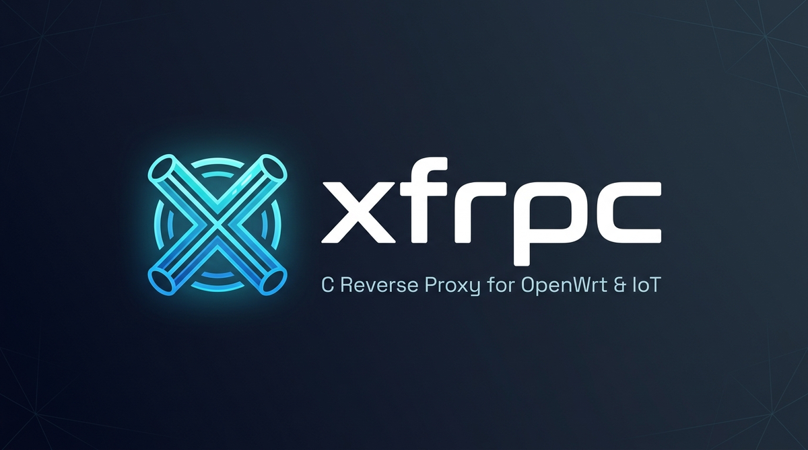

<p align="center">
  
</p>

[English](README.md) | [中文文档](README_zh.md)

## 什么是 xfrpc？

**xfrpc** 是基于纯 C 语言实现的轻量级高性能 [frp](https://github.com/fatedier/frp) 客户端，专为 **OpenWrt 路由器、嵌入式 Linux 及内存/闪存受限的 IoT 设备**设计。

相比官方 Go 版 `frpc`（通常 15MB+），`xfrpc` 在 `aarch64` OpenWrt 下的 `.apk` 安装包仅 **~197 KB（安装后约 418 KB）**，同时保持与官方 **`frps v0.72.0`** 核心协议及主流配置的全面兼容（支持 `wireProtocol` v1/v2、TOML 与 INI 配置）。

---

## 功能兼容性对比（对比官方 `frpc v0.72.0`）

### 已支持的核心与主流功能

| 分类 | 功能特性 | xfrpc | 官方 frpc (v0.72.0) |
| :--- | :--- | :---: | :---: |
| **代理类型** | `tcp`、`udp`、`http`、`https` | 支持 | 支持 |
| | `tcpmux`（`httpconnect`、`routeByHTTPUser`） | 支持 | 支持 |
| | `stcp`（加密 TCP 代理与 Visitor） | 支持 | 支持 |
| | `sudp`（加密 UDP 代理与 Visitor） | 支持 | 支持 |
| | `xtcp`（P2P NAT 打洞 + `fallbackTo`） | 支持 | 支持 |
| **传输层** | `tcp`、`tls`（系统 CA + `trustedCaFile`、双向 mTLS、`disableCustomTLSFirstByte`） | 支持 | 支持 |
| | `quic`（基于 `ngtcp2`，需 `-DENABLE_QUIC=ON`） | 支持 | 支持 |
| | `websocket`（`ws`）、`wss`（WebSocket over TLS） | 支持 | 支持 |
| | `transport.wireProtocol = v1` / `v2`（JSON + AES-256-GCM 控制流 AEAD） | 支持 | 支持 |
| | `transport.tcpMux`、`poolCount`、`dialServerTimeout`、`dialServerKeepalive`、`connectServerLocalIP` | 支持 | 支持 |
| **鉴权与安全** | `auth.method = "token"` / `"oidc"` | 支持 | 支持 |
| | `auth.additionalScopes`（`HeartBeats`、`NewWorkConns`） | 支持 | 支持 |
| | `useEncryption`（AES-128-CFB）与 `useCompression`（Snappy） | 支持 | 支持 |
| **流量与高可用** | `bandwidthLimit`（客户端令牌桶限速 / 服务端限速） | 支持 | 支持 |
| | `proxyProtocolVersion`（`v1` / `v2`） | 支持 | 支持 |
| | `loadBalancer`（`group`、`groupKey`）与 `healthCheck`（`tcp`、`http`） | 支持 | 支持 |
| | `metadatas`、`annotations`、`requestHeaders.set`、`responseHeaders.set` | 支持 | 支持 |
| **客户端插件** | `socks5`（支持 RFC 1929 用户名/密码认证） | 支持 | 支持 |
| | `http_proxy`（Basic 鉴权 + `CONNECT` 隧道与 HTTP 转发） | 支持 | 支持 |
| | `static_file`（`localPath`、`stripPrefix`、Basic 鉴权） | 支持 | 支持 |
| | `unix_domain_socket` | 支持 | 支持 |
| | `https2http`、`https2https`、`http2https`、`tls2raw` | 支持 | 支持 |
| | `http2http` | 部分支持（TCP 转发，暂不支持 `Host` 头重写） | 支持 |
| **配置与运维** | TOML（`frpc.toml`）与传统 INI 格式 | 支持 | 支持 |
| | `includes`（通配符多文件）、`start` 过滤、`enabled`、`loginFailExit`、`natHoleSTUNServer` | 支持 | 支持 |
| | `SIGHUP` 热重载、`xfrpc verify -c <file>`、`xfrpc version` | 支持 | 支持 |

### 明确不支持的功能（对比官方 `frpc v0.72.0`）

为保持嵌入式设备所需的极小体积与低内存占用，以下官方 `frpc` 外围特性**暂不支持**：

* **`kcp` 底层传输协议**
* **`VirtualNet`（`virtualNet` / `virtual_net` 虚拟网卡组网）**
* **`transport.proxyURL` 代理拨号**（配置解析时仅打印告警，暂未实现经 HTTP/SOCKS5 代理连接 `frps`）
* **`webServer`（客户端管理后台 UI / HTTP API）与 `metricsServer`（`/metrics`、`/healthz`）**
* **YAML / JSON 配置格式**、**Go `text/template` 模板语法**（`{{ .Envs.* }}`）及 **`ValueSource`**
* **`https2http` / `https2https` 插件中的 HTTP/2（`enableHTTP2`）** 以及 **`http2http` 的 `hostHeaderRewrite`**
* **CLI 子命令** `reload`、`status`、`stop`、`nathole discover` 以及无配置文件的命令行直启参数

### `xfrpc` 独有的额外功能

在对齐官方 `frpc` 核心能力之外，`xfrpc` 还针对路由器与 IoT 场景提供了以下增强功能：

* **内置实用插件**：
  * `telnetd`：内置轻量级 Telnet 服务端
  * `httpd`：内置 HTTP 静态服务
  * `instaloader` & `youtubedl`：媒体下载插件
* **分时段访问控制**：支持通过 `startTime` / `endTime`（INI 为 `start_time` / `end_time`）限制代理生效的小时范围（0–23 点）。
* **XDPI 协议识别与准入**：支持 `serviceType` / `service_type`（`mstsc`、`rdp`、`vnc`、`ssh`、`telnet`、`http`、`https`），在建立本地连接前校验协议特征。
* **兼容旧版 `type = "socks5"` 代理类型**：除标准 `[proxies.plugin]` 写法外，继续兼容直接将 `type` 设为 `socks5`。
* **OpenWrt 原生生态集成**：已进入 OpenWrt 官方软件源，支持 `apk` 包管理、UCI 配置（`/etc/config/xfrpc`）及 `luci-app-xfrpc` 网页管理界面。

---

## 架构图


---

## 编译指南

### 安装依赖（Ubuntu / Debian）

```bash
sudo apt-get update
sudo apt-get install -y build-essential cmake libjson-c-dev libevent-dev libssl-dev zlib1g-dev
```

### 标准编译

```bash
git clone https://github.com/liudf0716/xfrpc.git
cd xfrpc
cmake -B build
cmake --build build -j
```

**CMake 编译选项：**

| 选项 | 默认值 | 说明 |
| :--- | :--- | :--- |
| `-DUSE_WOLFSSL=ON` | `ON` | 优先使用 wolfSSL 作为 TLS 后端（未找到时自动回退到 OpenSSL） |
| `-DENABLE_QUIC=ON` | `OFF` | 通过 `ngtcp2` 启用 QUIC 传输支持 |
| `-DBUILD_STATIC=ON` | `OFF` | 构建全静态链接二进制文件（`-static`） |
| `-DDEBUG=ON` | `OFF` | 开启调试日志与 AddressSanitizer 内存泄漏检测 |

### 静态编译与交叉编译（Linux / Alpine / OpenWrt）

```bash
# Ubuntu/Debian 本地静态编译
cmake -B build-static -DDEBUG=OFF -DENABLE_SANITIZER=OFF -DBUILD_STATIC=ON
cmake --build build-static -j

# 使用 Docker 构建 Alpine 静态二进制
DOCKER_BUILDKIT=1 docker build --output out -f docker/Dockerfile.static .

# 使用 Docker 交叉编译（MIPS、MIPSEL、ARM、ARM64）
DOCKER_BUILDKIT=1 docker build --build-arg TARGET_TRIPLE=mips-linux-musl --output out -f docker/Dockerfile.cross .
DOCKER_BUILDKIT=1 docker build --build-arg TARGET_TRIPLE=mipsel-linux-musl --output out -f docker/Dockerfile.cross .
DOCKER_BUILDKIT=1 docker build --build-arg TARGET_TRIPLE=arm-linux-musleabihf --output out -f docker/Dockerfile.cross .
DOCKER_BUILDKIT=1 docker build --build-arg TARGET_TRIPLE=aarch64-linux-musl --output out -f docker/Dockerfile.cross .
```

### OpenWrt 安装与固件集成

* 固件编译配置：在 `make menuconfig` 中选择 `Network` → `Web Servers/Proxies` → `xfrpc`。
* 在线安装（OpenWrt 24.10+ 使用 `apk`）：
  ```bash
  apk update && apk add xfrpc luci-app-xfrpc
  ```

---

## 快速上手

先从 [fatedier/frp Releases](https://github.com/fatedier/frp/releases) 下载并在公网服务器启动 `frps`：

```toml
# frps.toml
bindPort = 7000
auth.token = "your_secret_token"
```

```bash
./frps -c frps.toml
```

### 1. 基础 TCP 代理与 v2 协议（TOML）

```toml
# xfrpc.toml
serverAddr = "your_server_ip"
serverPort = 7000
auth.method = "token"
auth.token = "your_secret_token"
transport.wireProtocol = "v2"

[[proxies]]
name = "ssh"
type = "tcp"
localIP = "127.0.0.1"
localPort = 22
remotePort = 6000
```

校验并启动：

```bash
xfrpc verify -c xfrpc.toml
xfrpc -c xfrpc.toml -f
```

### 2. WebSocket Secure（`wss`）传输

`wss` 模式会自动启用标准 TLS（不发送旧版 `0x17` 首字节），可直接穿透 Nginx / Caddy / Cloudflare 等反向代理：

```toml
serverAddr = "frp.example.com"
serverPort = 443
auth.token = "your_secret_token"
transport.protocol = "wss"
transport.wireProtocol = "v2"
transport.tls.serverName = "frp.example.com"

[[proxies]]
name = "router_ssh"
type = "tcp"
localIP = "127.0.0.1"
localPort = 22
remotePort = 6022
```

### 3. SUDP（安全 UDP）与 STCP 私有访问

**服务端提供方（`xfrpc_provider.toml`）：**

```toml
serverAddr = "your_server_ip"
serverPort = 7000
auth.token = "your_secret_token"

[[proxies]]
name = "secret_dns"
type = "sudp"
localIP = "127.0.0.1"
localPort = 53
secretKey = "shared_secret_key"
```

**访问端 Visitor（`xfrpc_visitor.toml`）：**

```toml
serverAddr = "your_server_ip"
serverPort = 7000
auth.token = "your_secret_token"

[[visitors]]
name = "dns_visitor"
type = "sudp"
serverName = "secret_dns"
secretKey = "shared_secret_key"
bindAddr = "127.0.0.1"
bindPort = 5353
```

### 4. 标准客户端插件（`socks5`、`http_proxy`、`static_file`、`tls2raw`）

```toml
[[proxies]]
name = "my_socks5"
type = "tcp"
remotePort = 1080
[proxies.plugin]
type = "socks5"
username = "user"
password = "password"

[[proxies]]
name = "my_http_proxy"
type = "tcp"
remotePort = 8080
[proxies.plugin]
type = "http_proxy"
httpUser = "user"
httpPassword = "password"

[[proxies]]
name = "my_static"
type = "tcp"
remotePort = 8000
[proxies.plugin]
type = "static_file"
localPath = "/www"
stripPrefix = "/static"
```

### 5. 常用命令与热重载

```bash
xfrpc verify -c xfrpc.toml      # 校验配置文件语法
xfrpc version                   # 查看版本号
xfrpc -c xfrpc.toml -f -d 7     # 前台调试模式运行
xfrpc -c xfrpc.toml -d 0        # 后台生产模式运行
kill -HUP $(pidof xfrpc)        # 发送 SIGHUP 热重载配置
```

---

## OpenWrt LuCI 网页配置界面

OpenWrt 用户可以配合官方 LuCI 仓库中的 [luci-app-xfrpc](https://github.com/openwrt/luci/tree/master/applications/luci-app-xfrpc) 使用，通过网页界面直观管理 `/etc/config/xfrpc` 配置。

---

## 参与贡献

欢迎阅读 [CONTRIBUTING.md](https://github.com/liudf0716/xfrpc/blob/master/CONTRIBUTING.md) 了解补丁提交与代码贡献规范。

## 交流反馈

QQ 群：[331230369](https://jq.qq.com/?_wv=1027&k=47QGEhL)

## Star 趋势

[](https://star-history.dera.page/#liudf0716/xfrpc&Date)

## 赞助打赏

支付宝打赏：


微信打赏：


